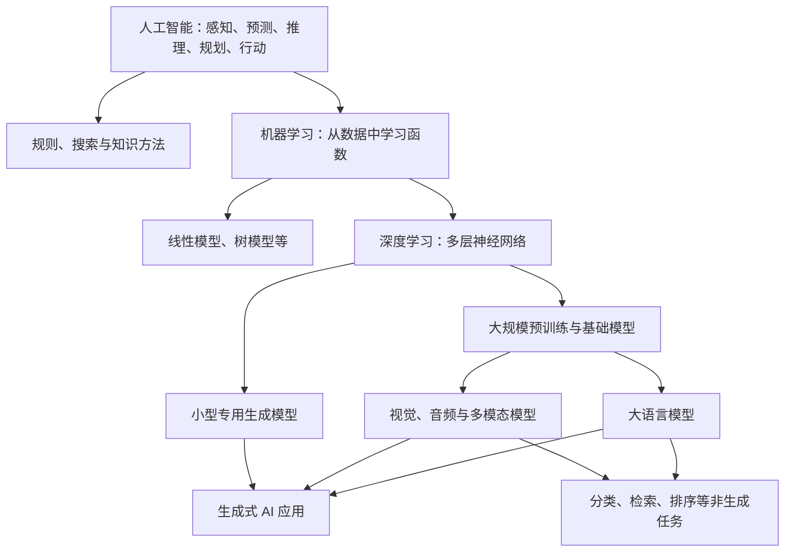
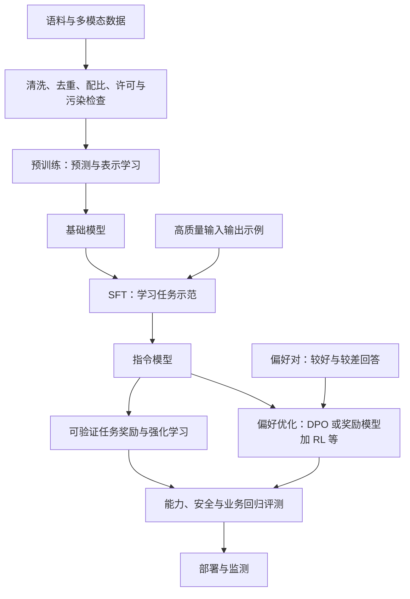
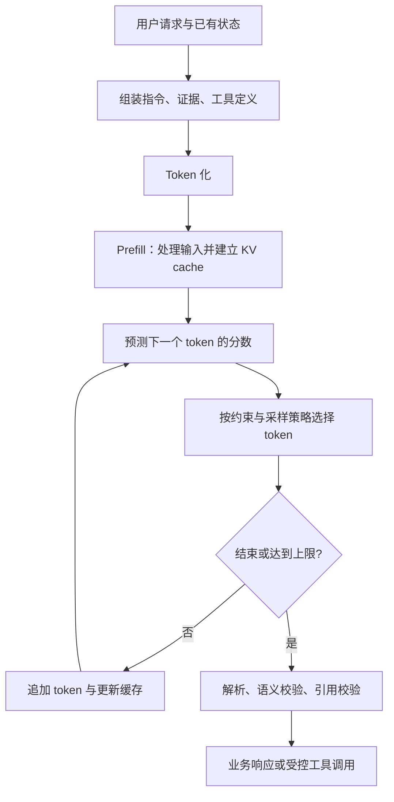
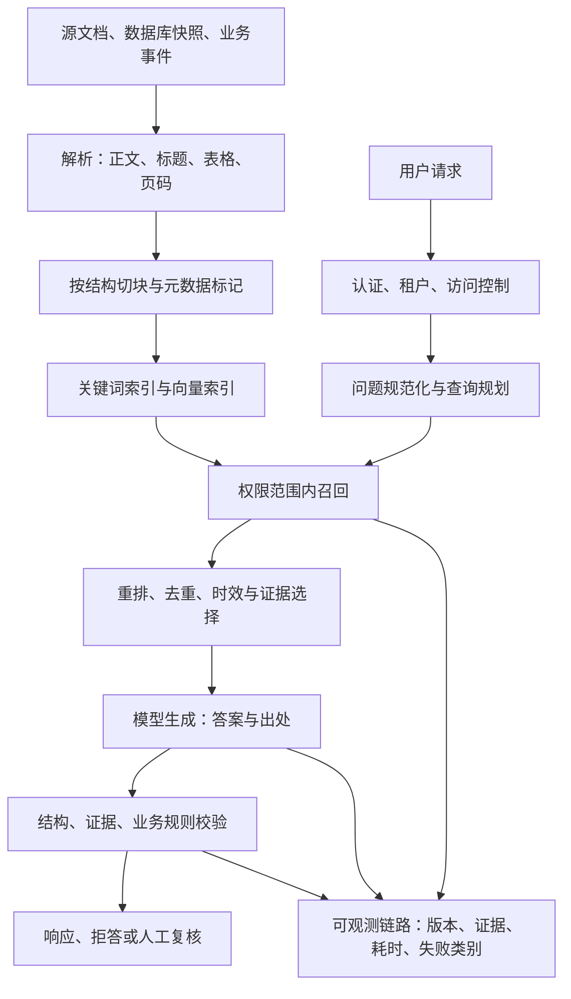

# 02 · 模型原理与应用工程

[专栏导读](./) · [参考资料](./references) · [来源与许可](./methodology)

> 整理自《从原理到业务的 AI 系统学习指南》，调研截止 2026 年 10 月 5 日。研究结论保留原有条件与来源；时效信息请结合原文日期阅读。

> 本篇面向有编程和后端基础的工程师。把模型看成一个从输入到概率分布的可学习函数，把 AI 应用看成围绕这个函数建立的业务系统，会比从产品名或框架名开始更容易形成稳定知识。本文中的业务示例与容量算例是调研者为解释原理构造的教学示例，不代表某家公司的生产数据。资料核验截止 2026 年 10 月 5 日。

**本篇的贯穿案例：把退款对话接入已有后端。** 假设用户说：“订单 A-1042 是定制款，还没发货，能帮我退掉吗？”订单服务返回“已付款、未发货、定制商品”；政策库中既有“普通未发货商品可退款”的一般规则，也有“定制商品须人工审核”的例外。系统正确的表现是查到订单和适用政策、说明需要审核，并在用户授权范围内建立审核请求。它不能因为一句“还没发货”就执行退款，更不能把“已提交申请”说成“已退款”。

这是一个虚构的教学业务规则，不是现实消费政策。后文将反复沿着这次请求看同一件事：**模型怎样表示与理解输入，应用怎样提供事实、约束行动，以及工程师怎样定位失败。**

## 2.1 先划清边界：AI、机器学习、深度学习、大模型与 AIGC

**人工智能（AI）**是研究和构建具有感知、预测、规划、推理或行动能力的系统的广泛领域。规则系统、搜索算法、知识表示和机器学习都属于其中。**机器学习（ML）**把部分行为规则从人工编写改为从数据中估计：例如，不为每一种垃圾邮件写规则，而是用邮件及标签学习分类函数。**深度学习（DL）**是使用多层神经网络的机器学习方法，层与层逐步变换表示，减少人工设计特征的工作。它适合复杂感知和语言任务，但并不意味着结构化表格上的每个业务预测都应该改用神经网络。

**大模型**强调规模与广泛迁移能力，通常指在大量数据上训练、可以适配多个任务的模型；“大”没有跨领域统一的参数门槛。**大语言模型（LLM）**是以语言序列为核心对象的一类模型。**生成式 AI / AIGC**强调根据条件生成文本、图像、声音、视频或代码的能力与应用形态。它与“大模型”交叉，却不是简单的上下级关系：小型生成模型也能生成内容，大型视觉编码器也可能主要用于识别而不生成。GPT-3 的工作展示了通过输入中的示例适配任务的能力；CLIP 则展示了大规模图文训练可以服务于检索和识别，不能把所有大规模多模态模型都理解成聊天机器人。[P046](https://arxiv.org/abs/2005.14165) [P007](https://arxiv.org/abs/2103.00020)



对后端工程师，最重要的变化是：传统接口多半有明确的输入输出契约，LLM 则同时有**可验证的外部契约**和**有误差的内部判断**。你可以保证返回 JSON 有字段 `category`，却不能仅凭 JSON 合法就保证分类正确。可以保证检索函数只访问当前租户的文档，却不能仅凭提示词“不要泄露”保证租户隔离。数据库约束、鉴权、幂等性和事务没有消失；它们成为围住概率组件的确定性边界。

这里还需要三个最小数学概念。**参数**是模型要学习的数值；**损失函数**把预测与训练目标之间的差异变成一个数；**梯度**表示微小改变参数会使损失怎样变化。训练程序通过反向传播计算梯度，再由优化器更新参数。你不必先掌握完整矩阵微积分才调用模型，但理解“目标是什么、误差怎样被惩罚、验证集是否独立”是判断模型是否在学正确事情的基础。Stanford CS336 将数据、模型、训练、系统与评估放在同一条课程主线上，适合在有了第一轮实践后系统补足这一层。[Stanford CS336，2025 课程](https://cs336.stanford.edu/spring2025/index.html)

## 2.2 Token 与 Embedding：把内容变成可计算的表示

### Token：模型读写的离散单位

**Token（词元）**是分词器把原始内容编码成的离散单位，模型看到的是 token ID 序列。它可能是一整个常用词、一部分单词、一个汉字、若干字节或特殊控制符。它解决的是“有限词表如何表示数量近乎无限的字符串”的问题。基于子词的分词方法会把常见片段保留为较大单位，把罕见词拆开，从而兼顾词表大小与序列长度。Sennrich 等人将字节对编码（BPE）用于神经机器翻译中的罕见词处理，是这一思路的重要代表；现代分词器还有其他变体，不能把 token 与 BPE 完全等同。[P043](https://arxiv.org/abs/1508.07909)

例如，一个技术词可能被拆成 `micro`、`service`，也可能被编码为单独一个 token；这只是示意，实际结果必须用目标模型的分词器查看。同一段中文、英文、JSON、源代码在不同词表下的 token 数不同。因此，“一 token 等于一个字”“中文固定比英文贵若干倍”都不是可靠容量规划方法。标点、空白、路径、长数字和编码后的数据也可能明显影响长度。

它对工程有四个直接影响：上下文预算通常按 token 计算；API 成本常与 token 数相关；切分文档应避免机械截断语义单元；要求模型精确数字符、处理任意长整数或保持复杂转义时，token 化方式可能放大困难。处理精确计数、金额计算、校验码和字节级一致性时，应让程序完成计算或验证。分词器版本还应与模型一起固定，避免服务和离线统计使用不一致的编码规则。

### Embedding：把离散对象映射到连续向量

**Embedding（嵌入向量）**是用一组浮点数表示一个对象，使模型能用矩阵运算处理它，也使相似性比较成为可能。对语言模型的输入，最基本的做法是按 token ID 从一个可学习矩阵取出向量；在后续网络层里，这个表示会与上下文交互。早期 word2vec 展示了从大规模文本学习词向量的实用价值。[P044](https://arxiv.org/abs/1301.3781)


图｜从预测周围词学习词向量。D2L 图 15.1.1。先看中心的 loves，再沿箭头看周围词：训练任务要求一个词的表示能帮助预测它的上下文。它说明词向量怎样从文本中得到学习信号；不能据此把词向量理解为人工定义的语义标签，也不能把这个浅层模型当作现代聊天模型的全部结构。原 SVG 仅转为白底 PNG，图内内容未改。 [原始资料](https://d2l.ai/chapter_natural-language-processing-pretraining/word2vec.html)；署名：Aston Zhang、Zachary C. Lipton、Mu Li、Alexander J. Smola 与 D2L 贡献者；Copyright 2019 Amazon.com, Inc. or its affiliates；许可：[CC BY-SA 4.0（教材文档及图；未采用仅适用于示例代码的 MIT 许可）](https://github.com/d2l-ai/d2l-en/blob/23d7a5aecceee57d1292c56e90cce307f183bb0a/LICENSE-SUMMARY)。


这里容易混淆两种东西。**模型内部的 token embedding**是神经网络中的组成部分；**用于搜索的 embedding 模型**则把整句、整段或图像映射为用于检索的向量，通常经过专门的训练目标和池化设计。不能随便从聊天模型里取一层平均值，就假定得到适合生产搜索的向量。DPR 使用查询与文档的双编码器学习检索表示，体现了“相似到适合完成任务”需要训练目标来定义。[P068](https://arxiv.org/abs/2004.04906)

后端类比是为文档增加一个可搜索的特征列，向量索引帮助查近邻；但它不是无损压缩，也不是“语义主键”。“订单取消”和“订单不可取消”可能词汇接近却结论相反；型号 `A-100` 与 `A-1000` 可能在语义上相近却属于不同商品。向量维度高不自动意味着效果好，余弦相似度也不是答案正确概率。对编号、专有名词和精确匹配，应同时考虑关键词检索与结构化过滤。

回到退款案例，“帮我退掉”与“取消订单”可能需要语义检索才能联系起来，而 `A-1042` 必须作为订单标识精确查找。“退款”和“不能退款”的向量可能仍然接近，因此检索结果只能成为待核验的候选。一个实用分工是：**数据库负责找对订单，检索负责找全政策，生成模型负责结合证据解释。** 三者都返回了结果，并不自动意味着这条链已经答对。

## 2.3 Attention 与 Transformer：怎样使用上下文

### Attention：根据当前需求选择性读取其他位置

**Attention（注意力）**是一种根据相关性混合信息的机制。它要解决的问题是：当前处理一个位置时，哪些其他位置对它有用？“小李把合同交给小王，因为他负责审批”中的“他”需要结合上下文理解；代码补全中的变量类型需要参考前面的声明。注意力让模型根据当前表示，对可见位置分配不同权重。

在简化的自注意力中，同一输入表示经过三个可学习的线性变换得到 **Q（query，查询）**、**K（key，键）**、**V（value，值）**。Q 与 K 的点积形成匹配分数，缩放与 softmax 将分数变为权重，再对 V 加权求和：

`Attention(Q,K,V) = softmax(QKᵀ / √dₖ + M)V`

其中 `dₖ` 是每个注意力头中键向量的维度，`M` 是掩码，禁止的位置可以加上负无穷。**因果掩码**让预测下一个 token 时只能读取当前位置及之前的信息，防止训练阶段偷看答案。多个注意力头并行学习不同投影，再合并结果。这个公式是 Transformer 的核心之一，但模型还依赖前馈网络、残差连接、归一化等组件。[P042](https://arxiv.org/abs/1706.03762)


图｜查询、键、值与加权汇总。D2L 图 11.1.1。从底部 q 开始：q 与左侧各 k 比较，得到中间的权重，再把右侧各 v 加权合成输出。匹配用 K，取回并混合的信息用 V，这解释了二者为何分开。图展示的是运算结构，权重高并不等于对应陈述为真，也不是完整的因果解释。原 SVG 仅转为白底 PNG。 [原始资料](https://d2l.ai/chapter_attention-mechanisms-and-transformers/queries-keys-values.html)；署名：Aston Zhang、Zachary C. Lipton、Mu Li、Alexander J. Smola 与 D2L 贡献者；Copyright 2019 Amazon.com, Inc. or its affiliates；许可：[CC BY-SA 4.0（教材文档及图）](https://github.com/d2l-ai/d2l-en/blob/23d7a5aecceee57d1292c56e90cce307f183bb0a/LICENSE-SUMMARY)。


它与数据库查询的类比仅在“查询—匹配—取值”层面有效。Q、K、V 不是人类可读的 SQL 条件和记录，匹配关系由训练学得；注意力权重也不是完整的因果解释。看到某个词权重很大，不能直接断言它就是模型给出结论的唯一原因。对开发者，最有用的理解不是逐个解释注意力头，而是知道模型必须从有限上下文中挑选信息，且干扰信息、位置和格式会改变这种选择。

**把注意力手算一次。** 假设某个查询对三个位置得到的缩放后分数是 `[1, 2, 0]`，经过 softmax，权重约为 `[0.245, 0.665, 0.090]`。如果三个值向量分别为 `[2, 0]`、`[0, 2]`、`[1, 1]`，输出就是：

`0.245 × [2, 0] + 0.665 × [0, 2] + 0.090 × [1, 1] ≈ [0.58, 1.42]`

这些是教学用的虚构数值。它们揭示一个关键区别：注意力并没有选中一条记录并原样返回，而是形成了新的混合表示。若某位置被因果掩码禁止，其权重会变成 0，其余可见位置重新归一化。模型再通过多层计算，把这些表示变成预测下一个 token 的分数。退款案例里，关注到了“未发货”不等于已经正确应用“定制款例外”；**注意力是信息处理机制，业务规则是否被遵守仍要通过输入输出与执行结果验证。**

### Transformer：可堆叠的表示更新模块

**Transformer**把注意力与逐位置前馈网络等组件堆叠起来，让每层更新 token 的表示。注意力负责跨位置交互，前馈网络对每个位置进行非线性变换；残差连接提供较稳定的信息与梯度路径，归一化帮助数值稳定。它在训练时可以并行处理同一序列中各位置的监督信号，避免传统递归结构必须逐步更新隐藏状态的主要限制。原始论文是在机器翻译中验证的编码器—解码器架构，不能把论文中的全部设计直接等同于今天每一个聊天模型。[P042](https://arxiv.org/abs/1706.03762)


图｜把注意力放回 Transformer 的整体结构。D2L 图 11.7.1。按自下而上阅读：Embedding 与位置信息进入网络，注意力和前馈层反复更新表示；绕过方框的线是残差路径。右侧底部的 Masked 表示不能看未来，左右之间的连线表示解码器读取编码结果。这是编码器—解码器结构，不能把右侧加左侧的整张图直接当作每个 GPT 类模型的架构。原 SVG 仅转为白底 PNG。 [原始资料](https://d2l.ai/chapter_attention-mechanisms-and-transformers/transformer.html)；署名：Aston Zhang、Zachary C. Lipton、Mu Li、Alexander J. Smola 与 D2L 贡献者；Copyright 2019 Amazon.com, Inc. or its affiliates；许可：[CC BY-SA 4.0（教材文档及图）](https://github.com/d2l-ai/d2l-en/blob/23d7a5aecceee57d1292c56e90cce307f183bb0a/LICENSE-SUMMARY)。


常见架构可以这样区分：

| 架构 | 可见信息与典型用途 | 应用理解 | 常见误区 |
|---|---|---|---|
| 编码器，如 BERT | 可以联合利用输入的左右上下文；表示、分类、抽取、排序 | 适合把已有内容理解成向量或标签 | “不能聊天，所以没有应用价值” |
| 解码器，如 GPT 类自回归模型 | 根据前缀预测后续 token；生成文本、代码或动作描述 | 一个通用的条件序列生成器 | “训练时也只能逐 token 串行计算所有位置” |
| 编码器—解码器 | 先编码输入，再根据输入及已生成内容输出 | 翻译、摘要等输入输出映射 | “它只是两套互不关联的模型” |

BERT 通过双向上下文预训练，再适配多种理解任务；GPT-3 通过自回归训练与提示中的任务描述、示例展示广泛迁移能力。它们的训练目标、可见信息和使用方式不同，没有一个架构在所有场景无条件更好。[P045](https://arxiv.org/abs/1810.04805) [P046](https://arxiv.org/abs/2005.14165)

### 位置、上下文窗口与“记住”的不同含义

注意力本身需要配合位置机制才能区分顺序。**位置编码**给模型提供 token 的位置或相对距离信息；RoPE（旋转位置编码）通过对 Q、K 进行与位置有关的旋转，使注意力分数体现相对位置关系，是常见方法之一。位置编码为长序列建模提供条件，却不能独自保证模型在任意长度上可靠工作。[P050](https://arxiv.org/abs/2104.09864)

**上下文窗口**是一次模型计算可使用的序列范围。在具体接口中，系统指令、用户消息、检索证据、工具定义、工具结果和生成内容都可能占用相关预算，准确计费与限制应查具体接口。它近似于一次调用可带入的工作区，而不是永久数据库。模型参数中的知识、当前上下文中的事实、KV cache 中的计算状态、应用保存的长期记忆，是四种不同机制。

“支持长上下文”只证明接口和模型能处理某种长度，不证明其中所有信息都被等效利用。Lost in the Middle 在多文档问答与键值检索中观察到，相关信息的位置会显著影响测试模型的表现，中部信息较难使用。它是特定年代模型与任务上的实验，不能把它直接当作所有新模型的性能上限；对工程更持久的启示是，要用实际任务测试不同位置、干扰文档数量和跨文档推理，而不只做单个关键词的“大海捞针”。[P022](https://arxiv.org/abs/2307.03172)

因此，重要约束应表达清楚，证据应减少冗余并保留出处；对长对话做摘要时应保存未解决事项、关键事实和来源，避免把未经验证的模型猜测写成长期事实。长窗口使“直接放入完整文档”成为可选方案，RAG 则解决从更大、更新更频繁、权限更复杂的数据集合中选择证据的问题，两者可以组合。

### 参数与 MoE：总规模不等于每次调用的工作量

**模型参数**是训练得到的权重。它们共同塑造模型的语言、知识与行为能力，却不是一个能逐条精确读取和删除的事实表。参数更多有时扩大可学习容量，但能力同时取决于训练数据、训练计算、目标、后训练和推理策略。Scaling Laws 研究了损失随参数、数据和计算规模变化的经验关系；Chinchilla 进一步强调固定训练计算预算下模型规模与训练 token 的配比。后者不能被简化为对所有现代模型、所有数据质量和所有部署成本都适用的固定比例。[P047](https://arxiv.org/abs/2001.08361) [P048](https://arxiv.org/abs/2203.15556)

**MoE（Mixture of Experts，混合专家）**在部分网络层设置多个子网络，由路由器为每个 token 选择少数专家执行。它解决的是“在不按总参数量同比增加每个 token 计算量的情况下提高容量”。Switch Transformer 是简化稀疏路由的重要研究，论文也直接讨论通信、训练稳定性等困难。[P049](https://arxiv.org/abs/2101.03961)

类比是请求路由到不同处理模块，但“专家”通常不是人工命名的财务、法律、写作部门，也不等于多 Agent。专家路由发生在神经网络内部，Agent 分工发生在应用控制流层。选型时同时看**总参数**、**激活参数**与服务实测：总参数影响权重存储和分布，激活参数影响部分计算量；跨设备通信、负载不均和内存带宽会让两个激活参数相近的模型表现不同。

## 2.4 多模态：输入不再只有文字，生成也不只靠逐词预测

**多模态模型**能够处理图像、文本、声音或视频等不同类型的信号，并学习它们之间的关系。它解决的是现实信息并非都能可靠转换成纯文字的问题：表格布局、流程图连线、语音情绪、视频中动作的先后关系，都可能在普通文本转换中丢失。

一种路径是把图像切成小块，再映射成向量序列；ViT 展示了 Transformer 处理图像块进行视觉识别的可行性。另一条关键路径是**跨模态对齐**：CLIP 用图文配对训练，让匹配的图像和文字在表示空间中更接近，可用于图文检索和零样本识别。多模态语言模型还可以把视觉编码器输出通过连接模块交给语言模型，或在统一架构中联合训练。它们都不意味着“把 JPG 当普通字符串输入”就能获得同样能力。[P071](https://arxiv.org/abs/2010.11929) [P007](https://arxiv.org/abs/2103.00020)

**扩散模型**提供了另一种生成机制：训练时学习从带噪数据中恢复信号，生成时从噪声出发，逐步得到符合条件的内容。DDPM 是重要基础；潜空间扩散模型先把图像压缩为学习到的表示，在较低维空间进行生成，再解码成图像，降低在高分辨率像素空间直接计算的负担。它与语言模型逐 token 生成的控制方式不同，因此推理成本与输出尺寸、采样步数、生成长度等因素有关。[P010](https://arxiv.org/abs/2006.11239) [P011](https://arxiv.org/abs/2112.10752)


图｜潜空间扩散的训练与生成路径。按三行阅读：A 先学习编码器 E 与解码器 D；B 固定这套表示，在加有已知噪声的潜变量上训练去噪模型；C 是纯文生图使用阶段，从随机潜变量出发，多步去噪后由 D 解码。文字条件参与去噪，而不是在最后给图像加标签。本图为依据 LDM 论文机制原创整理，省略具体损失与采样器，不是原论文 Figure 3 的翻译或临摹；条件编码器是否训练取决于配置。 [LDM 原论文](https://arxiv.org/abs/2112.10752)；可对照[作者官方原图](https://github.com/CompVis/latent-diffusion/blob/a506df5756472e2ebaf9078affdde2c4f1502cd4/assets/modelfigure.png)。


对于文档业务，一个实用选择是先比较 OCR 加文本模型、视觉模型直接理解页面、两者结合的系统。文本清晰、结构简单时，前者容易检索与引用；跨栏、复杂表格、图像关系重要时，视觉输入可能保留更多信息。限制在于视觉模型仍可能读错数字、漏看小字或误解坐标；生成模型画得逼真，也不代表物理关系、医学结构或法律文本正确。应把视觉依据、页码、区域位置与文字结论一起保存，按最终业务目标检验。

## 2.5 训练与后训练：先学语言与世界的规律，再塑造任务行为

### 预训练：从大量数据学习可迁移的模式

**预训练**是在面向大量任务使用之前，先用大规模数据训练模型。以自回归语言模型为例，给定前面的 token，预测下一个 token；文本本身提供训练目标，因此通常称为**自监督学习**，不需要人为给每个位置标标签。损失常写为目标 token 负对数概率的平均值。损失降低意味着模型更擅长压缩、预测该数据分布，并不直接等于业务问答更可信。

训练时，给出真实前缀监督各位置，也叫 **teacher forcing（教师强制）**；因果掩码让各位置不能看未来答案，但可以在矩阵运算中并行计算。模型生成时没有真实未来文本，必须用自己刚生成的内容继续预测。因此训练误差、自由生成表现和长任务成功率之间存在距离。

预训练不仅学习事实，还学习语法、代码模式、文体、常见推理结构与偏差。它学到的知识散布于参数，不附带每个结论的可靠来源索引。数据清洗、去重、语言和领域配比、质量过滤、个人信息处理、版权与授权安排、测试集污染控制，都属于训练设计。不能以“网页数量很多”替代数据质量判断。固定训练预算下，数据与参数投入的最优配比也需要实验；Chinchilla 的价值在于说明参数规模不是唯一杠杆，而不是提供无需复核的万能训练配方。[P048](https://arxiv.org/abs/2203.15556)

普通应用团队通常没有必要从零预训练。若需要让模型接触大量领域语料，可考虑**继续预训练**，但它需要足够计算、稳定数据与对通用能力退化的检查。若需求只是知道昨天更新的政策，建立可更新的检索索引通常更可控。



图中是常见组成方式，不是每个模型都必须按同一路线训练。数据、模型及奖励也可能在多轮迭代中共同更新。

### SFT 与指令微调：用示范教模型“怎样回答”

**SFT（Supervised Fine-Tuning，监督微调）**是在已有模型基础上，用明确输入输出对继续训练。**指令微调**是 SFT 的常见用途：输入是一项指令及上下文，输出是期望回答，模型学习遵循这种任务形式。SFT 也可以训练代码修改、结构化抽取和工具调用轨迹，二者不是互斥技术。

例如，将报障描述变成 `severity`、`product`、`summary` 三个字段，需要收集覆盖正常情况、歧义、信息不足和异常输入的可靠示例。训练让模型更倾向于产生这些示例中的行为，减少每次提示所需的解释。它适合高频、稳定、示范充分的任务；不适合把少量随时变更的产品事实当作不可审计的参数记忆。

InstructGPT 以示范数据做 SFT，再用偏好数据进行后续优化。论文报告在其提示分布和人工评审下，较小的后训练模型可以比大得多的基础模型更受偏好。这支持“训练目标和行为适配非常重要”，并不证明小模型在所有知识、推理或代码任务上超过大模型。[P052](https://arxiv.org/abs/2203.02155)

SFT 的常见失败来自标签不一致、训练示例只有简单正例、遗漏拒答与缺失字段、训练和评测来自同一文档或模板、学习率过大以及输出格式和线上聊天模板不一致。若训练损失下降而新样本效果下降，应检查过拟合与数据泄漏；若知识正确但格式错误，应先确认提示和模板；若格式漂亮但事实错，继续堆同类格式示例未必有效。

### LoRA 与 QLoRA：改变“怎样更新参数”，不是改变任务目标

**LoRA（低秩适配）**冻结原模型权重，在部分权重矩阵旁训练较小的低秩增量。简化表示为 `W' = W + BA`，其中 A、B 的中间维度远小于 W 的维度。它解决全参数微调中可训练参数、梯度与优化器状态过大的问题。部署时在条件允许的情况下可以合并增量，也可以动态挂载适配器。[P053](https://arxiv.org/abs/2106.09685)

例如，一个通用模型负责多个固定文档抽取任务，可以保存较小的任务适配器，而不是为每项任务复制完整可训练权重。它适合算力有限、需要任务适配或多个版本并存的团队。限制是冻结基础权重并没有消除基础模型的加载成本；低秩容量、训练模块、数据质量和任务跨度影响效果，不能保证和全参数微调在任何任务都相同。合并后权重还需要重新验证量化与部署表现。

**QLoRA**进一步把冻结的基础模型以低比特表示保存，并训练 LoRA 适配器，以降低微调所需显存。原论文结合 4-bit NormalFloat、双重量化与分页优化器等方法，在其配置中展示了单张 48 GB GPU 微调 65B 参数模型的可行性；这不是说任意 65B 模型、任意序列长度或任意训练框架都能无条件复现。计算、激活和适配器也并非全部变为 4 bit。[P054](https://arxiv.org/abs/2305.14314)


图｜全量微调、LoRA 与 QLoRA 的内存来自哪里。QLoRA 论文 Figure 1。横向比较三列：LoRA 缩小的是需要更新的参数及其优化器状态，QLoRA 进一步压低冻结基础权重的存储；绿色箭头说明梯度仍须穿过相关计算，粉色箭头表示分页优化器与 CPU 的数据流。图中方框是机制示意，不能用面积直接估算总显存；激活、序列长度与实现开销仍需另外计算。由原 PDF 第 3 页完整裁出图 1 与图题，图内内容未改。 [原始资料](https://arxiv.org/abs/2305.14314)；署名：Tim Dettmers、Artidoro Pagnoni、Ari Holtzman、Luke Zettlemoyer，QLoRA（2023）；许可：[CC BY 4.0（已核验 arXiv 摘要页 Rights 链接；保留原 Figure 1 与英文图题）](https://creativecommons.org/licenses/by/4.0/)。


最重要的概念区分是：SFT、DPO 描述训练目标或数据利用方式；全参数微调、LoRA、QLoRA 描述更新参数与内存管理方式。完全可以使用 LoRA 做 SFT，也可以用参数高效方式做偏好优化。“用了 LoRA，所以不需要标注数据”“QLoRA 就是推理用的 4-bit 模型”都不成立。

**LoRA 到底少训练多少参数？** 只看一个输入、输出维度均为 4096 的线性层，完整权重矩阵有 `4096 × 4096 = 16,777,216` 个参数。若低秩维度取 8，令 A 的形状为 `8 × 4096`、B 为 `4096 × 8`，可训练增量只有 `65,536` 个参数，是该矩阵的约 `0.39%`，即降为原来的 1/256。推理计算可以写成 `Wx + B(Ax)`；训练冻结 W，只更新 A、B。这里为清楚起见省略 LoRA 的缩放系数。

这个算例只比较**一个矩阵的可训练参数量**，不是整模型的实测显存缩减倍数。基础 W 仍要参与前向计算，中间激活仍可能需要保留，其他被训练的模块也要占空间；QLoRA 才进一步压缩基础权重的存储。退款业务若要让模型稳定生成审核单字段，可以考虑用可靠示范做 LoRA/SFT；“订单今天是否发货”则应来自实时 API。把不断变化的订单状态放入训练集，既难更新，也难证明某次回答依据的是当前事实。[P053](https://arxiv.org/abs/2106.09685) [P054](https://arxiv.org/abs/2305.14314)

### RLHF、DPO 与强化学习：示范之外，利用偏好或结果反馈

**强化学习（RL）**让策略通过行动及其奖励来改进。语言生成中，策略可以是模型，动作可以是生成 token 或工具调用，奖励可以来自人工偏好模型、测试通过情况或环境任务结果。关键困难是怎样把最终成败归因到长序列里的选择，以及奖励是否真的代表目标。PPO 是限制策略每次改变幅度的一类实用方法，最初论文验证于控制和游戏任务，后来被用于语言模型训练；PPO 不是 RL 的同义词。[P056](https://arxiv.org/abs/1707.06347)

**RLHF（从人类反馈中进行强化学习）**的典型流程是：先收集同一输入下多个回答的偏好排序，训练奖励模型，再优化生成模型以获得更高奖励，同时限制它偏离参考模型过远。人类往往更容易判断 A 比 B 好，而不容易为所有问题写完美答案。摘要偏好学习与 InstructGPT 是这种思路的重要实例。[P057](https://arxiv.org/abs/2009.01325) [P052](https://arxiv.org/abs/2203.02155)

**DPO（Direct Preference Optimization，直接偏好优化）**从特定的带约束偏好优化形式出发，直接用“更喜欢 / 不喜欢”的回答对训练模型，省去经典流程中显式训练奖励模型再在线采样做 RL 的步骤。可以把它理解成相对参考模型，提高偏好回答相对于非偏好回答的倾向。它通常比完整在线 RL 流程简单，但仍依赖偏好数据、参考模型与超参数。[P055](https://arxiv.org/abs/2305.18290)

在代码和数学中，**可验证奖励**可以用测试或答案校验替代部分主观评审。例如程序通过多少测试，就提供相应反馈。但测试覆盖率不足时，模型可能学到迎合测试而非正确实现需求；只奖最终答案，也可能不鼓励稳健的过程。偏好优化同样会继承评审者偏差：长度、语气、自信可能被误当作质量。奖励变高、回答更讨喜、事实更正确、业务风险更低，是四件需要分别验证的事。

| 方法 | 改进的主要对象 | 必要数据或反馈 | 比较适合 | 核心限制 |
|---|---|---|---|---|
| 预训练 / 继续预训练 | 广泛表示、语言与领域分布 | 大量可用语料 | 训练基础能力或明显领域迁移 | 昂贵；不提供可审计的即时知识更新 |
| SFT / 指令微调 | 输出行为与任务映射 | 高质量示范 | 固定格式、特定任务、工具轨迹 | 易学到数据中的错误与狭窄模式 |
| LoRA / QLoRA | 更新方式与资源消耗 | 取决于所配训练目标 | 资源受限的微调与适配器管理 | 仍需基础模型、数据和评测 |
| RLHF | 人类偏好下的行为 | 偏好比较及奖励模型 | 开放式回答的偏好塑造 | 奖励偏差、训练复杂度、过优化 |
| DPO | 偏好回答的相对倾向 | 偏好对、参考模型 | 可获得可靠离线偏好数据 | 分布覆盖和偏好质量决定上限 |
| 带可验证奖励的 RL | 环境中的可验证成功 | 测试、规则或任务结果 | 代码、数学及可模拟任务 | 奖励漏洞、环境成本和泛化 |

## 2.6 推理：一个回答如何生成，资源消耗在哪里

### 从概率分布到一个具体回答

**推理（inference）**是用训练好的权重处理新输入。在自回归语言生成中，模型计算词表上“下一个 token”的分数，经过 softmax 变成概率，再由解码策略选出一个 token，追加到上下文中，重复直到结束条件满足。通常权重不因这次对话而更新；上下文变化可以改变回答，却不等于模型进行了梯度训练。

**贪心解码**每步选择最高分 token，容易理解，却未必得到整体最佳答案。**Temperature（温度）**通过缩放分数改变分布陡峭程度：低温通常更集中，高温更分散；**top-k**只从概率最高的 k 个候选中采样；**top-p / nucleus sampling（核采样）**按概率降序排列，保留累计概率达到阈值的最小前缀集合，再从中采样。核采样论文分析了开放式生成中单纯追求高似然可能出现的重复和乏味问题，并提出动态截断尾部的方法。[P066](https://arxiv.org/abs/1904.09751)

创意草稿可能需要多样性，字段抽取则通常偏重稳定性。但温度不是“事实性旋钮”：降低温度会让模型更稳定地输出其高概率答案，错误答案也可能更稳定。即使使用贪心策略，分布式数值计算、服务版本变化、并发调度或其他实现细节也可能影响完全可重复性。需要严格一致的业务字段时，优先通过 schema、程序校验与规范化实现；需要实验可复现时，记录模型版本、输入、解码参数和执行配置，而不是只写“temperature=0”。



### Prefill、Decode 与三种不同的缓存

**Prefill（预填充）**处理已有输入，通常能利用较大的并行矩阵运算；**Decode（解码）**不断生成新 token，存在前后依赖。两阶段的瓶颈不同，不能只看一个“tokens/s”就评判服务。很长的输入主要增加 prefill 工作和后续缓存，很长的输出主要增加串行解码轮数；许多小批量解码场景还受权重读取与内存带宽约束，实际情况应通过分析工具确认。

**KV cache**保存每层中已经处理过的 token 的 K、V，生成后续 token 时复用，避免重复计算过去的键和值。它是本次序列或兼容前缀的计算状态，不是事实数据库，也不会让模型自动记住被删掉的对话。常见全注意力实现的缓存会随已处理长度与同时服务的请求数增加。[Hugging Face：How caching works](https://huggingface.co/docs/transformers/main/cache_explanation)

**为什么过去的 K、V 可以不重算？** 用一个只有 6 个 token 的教学输入来看：prefill 可以并行处理这 6 个位置，但每个位置仍受因果掩码约束；随后模型预测第 7 个 token。第 7 个 token 被选定后，下一轮计算它的新 Q、K、V，把新 K、V 追加到缓存，再用它的 Q 读取已经存在的键值，预测第 8 个 token。对于固定权重的标准因果 Transformer，早先位置看不到新追加的内容，所以它们原先的表示不需要因追加内容而改变。这就是缓存有效的原因；并不意味着每轮只读取一个 token，当前查询仍可能需要访问整个可见前缀的缓存。

这也解释了缓存失效：如果把前面“普通商品”改成“定制商品”，受影响位置及之后的状态不能照搬；如果模型或位置编码配置改变，旧缓存也未必兼容。退款助手可尝试复用稳定的提示前缀，但订单状态和用户权限属于本次业务输入。缓存命中只说明计算可复用，不证明事实仍然有效。[Hugging Face：缓存机制](https://huggingface.co/docs/transformers/main/cache_explanation)

要区分三类缓存：

| 缓存 | 保存什么 | 合适用途 | 主要失效与隔离问题 |
|---|---|---|---|
| KV cache | 注意力中间张量 | 一次生成中复用前缀计算 | 模型、token 前缀、位置或缓存布局不兼容 |
| 前缀缓存 | 相同前缀的可复用计算 | 稳定系统提示、共享材料 | 前缀一致性、保留期限、租户与敏感信息边界 |
| 应用响应缓存 | 完整答案或业务结果 | 重复、时效要求可控的请求 | 权限、资料版本、时间、个性化和语义误命中 |

语义缓存把相近问题的回答复用给新问题，风险比精确键缓存更高。“退款期限是几天”和“特价商品退款期限是几天”可能向量很近，却不应共享答案。缓存键至少要考虑用户或租户权限、知识版本、模型与提示版本、重要业务条件；不能只用问题文本。

### 显存从哪里来：先算数量级，再实测

推理显存大致由权重、KV cache、临时激活、算子工作空间和运行时开销组成。粗略的权重估算是：

`权重字节数 ≈ 参数数量 × 每个参数存储字节数`

**教学算例**：7 billion 参数以 16-bit 保存，纯权重约为 14 GB（十进制），约 13.0 GiB；4-bit 的理想纯数值载荷约 3.5 GB。但量化还需要缩放参数、分组信息及可能的高精度层，不能据此断言 4 GB 显卡可稳定运行。训练还需要梯度、优化器状态和大量激活，所需资源通常比单纯加载模型高得多。

标准全注意力的 KV cache 可以做如下估算，具体架构可能不同：

`KV 字节数 ≈ 2 × 层数 × batch × 已缓存 token 数 × KV 头数 × 每头维度 × 每元素字节数`

**教学算例**：32 层、batch=1、8192 token、8 个 KV 头、每头 128 维、2 字节存储，对应约 1 GiB 的纯 KV 张量；如果 KV 头增加为 32，约为 4 GiB。它说明长上下文、高并发与显存需求如何相互影响，并不是某个具体模型的部署保证。

**MQA（多查询注意力）**让多个查询头共享一组 K、V，**GQA（分组查询注意力）**让一组查询头共享 K、V，以减少缓存及数据读取压力。GQA 论文报告了其测试配置中接近多头注意力的质量和接近 MQA 的速度；质量与速度仍要在目标模型上复核。[P051](https://arxiv.org/abs/2305.13245)

### 量化、蒸馏、计算优化与调度是不同层的杠杆

**量化**使用更低位宽表示权重、激活或缓存，目的是节约存储和数据搬运，并在适合的硬件与算子上加速。训练后量化可使用校准数据估计怎样压缩更少损失；量化感知训练则在训练过程中考虑量化影响。GPTQ 利用近似二阶信息进行权重量化，AWQ 根据激活统计保护重要权重通道，LLM.int8() 则特别处理对低精度计算敏感的异常值特征。[P062](https://arxiv.org/abs/2210.17323) [P063](https://arxiv.org/abs/2306.00978) [P064](https://arxiv.org/abs/2208.07339)

这类研究支持低精度部署的可行性，但“4-bit”没有统一的效果或速度保证。校准数据、量化粒度、模型架构、是否量化激活、实际 kernel 和硬件支持都会影响结果。短问答平均分不变，也可能掩盖长文本、少数语言、代码或函数调用上的退化。量化后的模型应视为一个需要回归评测的新发布版本。

**蒸馏（distillation）**让较小的学生模型学习较大的教师模型的输出分布或行为。经典知识蒸馏利用软目标表达类别间关系；在生成任务里，也常用教师生成并筛选的答案或轨迹训练学生。它适合把一个边界明确、重复量大的任务做得更便宜，代价是要收集适合部署分布的数据并验证教师错误是否被传递。蒸馏是训练新模型；量化是改变数值表示；两者可以叠加。[P065](https://arxiv.org/abs/1503.02531)

**FlashAttention**重点优化 GPU 内存层级间的数据读写，通过分块计算减少巨大注意力中间矩阵的存储；原方法计算的是精确注意力，不应说成“近似注意力，所以牺牲质量换速度”。FlashAttention-2 进一步改进并行与工作划分。它们没有把一般稠密注意力的理论计算量从平方变成线性，只是大幅改进了实际内存和执行效率。[P058](https://arxiv.org/abs/2205.14135) [P059](https://arxiv.org/abs/2307.08691)

**PagedAttention / vLLM**解决的是服务时 KV cache 的动态内存管理问题，借鉴分页思想减少碎片并支持共享。它能让有限显存同时容纳更多有效请求，但不能凭空消除缓存内容本身的容量。**连续批处理**则在生成轮次间动态加入或移除请求，避免固定 batch 被最长请求拖住。总体吞吐可能提高，单个用户等待多久仍受队列与调度策略影响。[P060](https://arxiv.org/abs/2309.06180)


图｜真实服务中的 KV 缓存按层类型与物理块管理。vLLM 设计文档 Memory Layout 插图（原文未编号）。这是进阶阅读：先看第一行，不必追每个坐标；黄色对应 full.0，浅绿与深绿对应两个滑动窗口层，它们共享一个缓冲区但占不同块。示例展示 10 个全注意力层和 20 个滑动窗口层如何分组管理，并非一个通用模型的显存配额。它解释缓存分配为何依赖模型结构，不能从此图推出固定的吞吐提升倍数；文档明确说明该设计仍可能变化。 [原始资料](https://docs.vllm.ai/en/latest/design/hybrid_kv_cache_manager/)；署名：vLLM 项目贡献者，Hybrid KV Cache Manager 设计文档；许可：[Apache-2.0（官方仓库文档资源，已保留完整 LICENSE；图片未改）](https://github.com/vllm-project/vllm/blob/155488d853a0bc42df227dbfc74005b3fd488e94/LICENSE)。


**推测解码（speculative decoding）**先由更便宜的草稿机制提出多个候选 token，再由目标模型并行验证。严格的接受与拒绝采样方案可保持目标分布；速度收益取决于接受率、草稿开销、目标模型规模、批量与硬件，不能把任意“先小模型写、再大模型改”都称为分布等价的推测解码。[P061](https://arxiv.org/abs/2211.17192)

| 手段 | 主要改动层 | 主要收益 | 必须检查的代价 |
|---|---|---|---|
| 量化 | 数值表示与 kernel | 权重 / 缓存容量、带宽 | 任务退化、硬件支持、反量化成本 |
| 蒸馏 | 训练与模型规模 | 每次调用计算和部署成本 | 数据生产、能力损失、分布变化 |
| FlashAttention | 注意力算子实现 | 中间内存与计算效率 | 设备、精度与形状兼容性 |
| GQA / MQA | 注意力架构 | KV cache 与读取量 | 质量权衡；通常不是运行参数随意切换 |
| PagedAttention | KV 内存管理 | 减少碎片、容纳更多请求 | 实际并发与调度行为 |
| 连续批处理 | 服务调度 | 总吞吐与资源利用率 | 尾延迟、长短请求公平性 |
| 推测解码 | 解码执行 | 减少目标模型串行轮次 | 草稿接受率及额外资源 |
| 路由与级联 | 应用系统 | 用较低成本处理简单任务 | 路由误判、回退延迟与分布漂移 |

### 延迟、吞吐和成本如何一起看

**TTFT（Time To First Token，首 token 延迟）**表示用户等多久才看到开始输出；**TPOT（Time Per Output Token）**或 token 间隔反映输出流畅度；**端到端延迟**还包括检索、工具、网络和后处理；**吞吐量**表示单位时间可完成多少请求或生成多少 token。必须说明是输入 token、输出 token，还是请求吞吐，以及固定的输入输出长度和并发量。

一次请求可近似拆成：`排队 + 检索/工具准备 + prefill + 逐 token 解码 + 校验/后处理`。这是定位用的分解，不是通用精确性能模型。串行工具调用会直接累加延迟；没有依赖的检索或检查可并行。流式输出改善用户感知，却不会必然降低 GPU 总工作量。

调优应针对服务等级目标（SLO）：例如同时约束 p95 端到端延迟、失败率与每个成功任务的成本。p95 表示 95% 请求不超过该延迟，能揭示均值掩盖的慢请求。压测必须保留实际长短输入分布、突发并发和工具耗时；只拿一个短问题测最快输出，不能回答生产容量问题。

成本也应按**成功完成业务的单位成本**比较。一个便宜模型需要多次重试、人工返工，可能比一次完成的较强模型昂贵。反过来，稳定高频的简单分类用小模型、规则或传统机器学习足够时，默认调用最强模型会浪费成本。自建部署还要计入空闲 GPU、冗余、监控、升级、排障与人员成本，不能只拿 API 单价与 GPU 租金相除。

## 2.7 应用设计：提示词、RAG、结构化输出和工具如何组合

### 提示词：写清任务契约，再用失败样本改进

**提示词（prompt）**是模型在本次调用中接收的指令、示例及上下文。它解决“通用模型在当前任务中应怎样行动”的问题，不改变权重。一个可靠的任务说明通常包括：任务目标、输入的含义、可用证据、输出契约、缺失信息的处理以及少量覆盖边界的示例。少样本提示是在输入中展示示范；与 SFT 不同，这些示范不会通过这次请求自动永久写入参数。[P046](https://arxiv.org/abs/2005.14165)

例如工单分类可以明确：“仅从提供的描述判断；允许 `unknown`；不得推测客户等级；输出 schema 所定义的字段；遇到产品名无法对应时保留原文并标记需复核。”比“你是顶级客服专家，请认真回答”更有可测试的行为含义。这里不是否认角色提示可能有用，而是优先让需求可验证。

改提示词的工程方法是：先保存失败输入与期望行为，判断究竟是任务不清、示例不足、证据缺失、工具失败还是能力不足；每次针对一类原因修改，再在独立样本上回归。不断追加“绝对不要犯某错”可能造成矛盾、挤占上下文并损伤其他任务。需要记录提示模板版本、示例选择和资料版本，使每个线上回答可以追溯到配置。

### 结构化输出：把“能解析”与“能入库”分开

**结构化输出**要求模型生成满足 JSON schema、枚举、正则或文法的内容。它解决自然语言输出难以稳定对接程序的问题。一种办法只是要求模型按格式写，再事后校验；另一种是**约束解码**，在每一步屏蔽不允许的 token，把生成限制在指定语法中。Efficient Guided Generation 将生成与状态机、文法约束联系起来；vLLM 文档展示了 JSON schema 等可选约束方式。[P072](https://arxiv.org/abs/2307.09702) [vLLM：Structured Outputs](https://docs.vllm.ai/en/v0.31.0/features/structured_outputs/)

但语法合法仅是第一层。`{"amount": 1000000, "currency": "CNY"}` 可以完全合法，却从未出现在发票上。应再检查字段关系、金额范围、证据位置、实体是否存在、当前权限与业务规则。schema 要允许 `null`、`unknown`、`needs_review` 等真实状态，避免模型为了填满必填字段而编造。被截断、拒答、网络失败、工具错误也应在系统层有明确状态，不能统统当作可解析业务结果。

以下是教学用契约，不绑定某一家 SDK：

```json
{
  "answer": "符合条件的订单可以申请退款。",
  "status": "supported",
  "evidence": [
    {"document_id": "policy-2026-09", "section": "3.2"}
  ],
  "missing_information": ["订单是否属于例外品类"]
}
```

消费端应验证 `document_id` 真的是这次授权检索的文档，`section` 存在，回答中的重要结论能被证据支持。模型生成一个貌似精确的引用标识，不等于它已经证明了事实。

### RAG：为本次回答提供外部证据

**RAG（Retrieval-Augmented Generation，检索增强生成）**先从外部资料中找到相关内容，再让生成模型基于这些资料作答。它要解决模型参数知识可能过时、缺乏私有信息与难以给出出处的问题。原始 RAG 论文把参数化生成器与非参数文档索引组合，并研究联合微调；今天工程中“RAG”常泛指检索加生成流水线，未必训练检索器和生成器，也未必使用向量数据库。REALM 则把检索引入预训练，说明检索可以发生在训练和应用的不同层次。[P067](https://arxiv.org/abs/2005.11401) [P069](https://arxiv.org/abs/2002.08909)

一个可维护的 RAG 系统有离线和在线两条链路。离线链路负责文档解析、结构恢复、切块、元数据与权限标记、建立索引、版本更新和删除；在线链路负责理解问题、权限过滤、召回、排序、选择上下文、生成以及证据校验。只搭出“embedding → 向量检索 → LLM”通常只覆盖了中间一段。



**关键词检索**擅长标识符与词项精确匹配；**稠密向量检索**擅长相近含义但不同表述；**混合检索**结合两者；**reranker（重排器）**在较小候选集合中更仔细比较查询与文档的相关性。DPR 的研究说明双编码器可以有效学习语义召回，但论文在开放域问答上的优势不能直接证明任意企业语料里向量检索都比 BM25 好。[P068](https://arxiv.org/abs/2004.04906)

切块也没有通用最佳长度。过小可能把条件和结论切开，过大可能引入噪声并增加成本。应按标题、段落、表格、代码函数等结构保留可理解单元，用父子文档关系或邻接补全恢复上下文。对于版本化政策，日期、生效状态和适用产品是检索条件；对于多租户知识库，访问控制应在可信服务端执行。不能先把所有租户内容给模型，再要求它不要引用无权限内容。

查询改写可以将“它支持退款吗”补全为当前订单对应产品的问题，但可能错误猜测指代。HyDE 先生成一个假设答案文档，再用其向量检索真实文档，改善某些无标注检索任务；它生成的假设内容本身不是真实证据，必须与最终检索结果严格区分。只有诊断显示“查询与文档表述差异”是瓶颈时，才有理由引入这类额外步骤并承担成本。[P070](https://arxiv.org/abs/2212.10496)

RAG 常见的失败链是：资料根本不存在 → 解析丢失信息 → 切块损坏语义 → 权限或过滤条件错误 → 召回漏掉证据 → 重排把证据挤掉 → 上下文过长或冲突 → 生成忽略证据 → 引用附错位置。排查时按这条链往下查，比统一归因于“模型幻觉”有效。一个有用的诊断实验是直接把正确证据提供给生成器：若仍回答错误，优先改生成与任务定义；若恢复正确，优先修检索链路。

**把“没答对”拆成可验证的对照实验。** 对贯穿案例，保留一份很小但完整的正确证据包：订单状态、普通商品规则、定制商品例外，以及各自版本和出处。先固定生成提示与模型，对比实际检索证据和这份人工整理的证据包；这个实验是工程诊断，不是宣称人工证据代表线上分布。

| 实际观察 | 更可能的问题位置 | 下一步验证 |
|---|---|---|
| 实际检索只找到“未发货可退款”，换成完整证据后答对 | 解析、切块、召回、重排或适用条件过滤 | 检查例外条款是否入库、是否被切断、是否在候选中被挤掉 |
| 完整证据已给出，仍建议直接退款 | 生成阶段的规则应用、冲突处理或任务定义 | 明示例外优先级，增加相似反例；比较其他模型并做保留集回归 |
| 文本正确说“需要审核”，工具却执行退款 | 工具契约与执行边界 | 禁止该状态直接退款，校验动作类型及服务端资格规则 |
| 工具只建立审核单，回答却说“退款成功” | 工具结果解释与最终响应 | 要求回答映射真实执行状态，并校验“申请中”和“已完成”的区别 |

这个例子说明检索命中了“相关文档”仍不够：本题需要的是**足以支持结论的证据集合**。评测可分别记录例外条款是否找全、结论是否正确、动作是否合规、执行状态是否如实陈述；只给最终回答打一个分，会隐藏应修哪个组件。

### 工具调用：模型提出动作，系统决定能否执行

**工具调用**让模型用结构化方式选择一个函数及其参数，宿主程序执行后再把结果交给模型。它解决模型不能独自可靠完成实时查询、精确计算和外部状态变更的问题。Toolformer 探索通过训练学习何时调用 API、传什么参数、怎样使用结果；它不意味着任何模型只要列出一个函数名就会可靠调用。[P018](https://arxiv.org/abs/2302.04761)

以查询订单为例，模型可以生成 `get_order(order_id)`，但实际用户身份应来自服务端会话，不能采信模型自行填写的 `user_id`。查询到的订单状态由业务系统提供，模型负责解释；退款则应经过独立的权限、资格、额度与幂等校验。对写操作采用预览、确认、执行结果查询和审计，使模型“想做什么”与系统“已做成什么”始终分开。

好的工具接口需要让用途边界清晰、参数易理解、返回内容足够但不过量。让工具支持服务端搜索和分页，通常比一次返回全部数据库记录再让模型挑选更稳妥。Anthropic 的工具工程分享特别强调基于真实任务轨迹观察无效参数、重复调用、上下文浪费等问题，并用保留测试集验证工具修改。这属于厂商自身实践总结，不是适用于所有模型与业务的普遍定律。[Anthropic：Writing effective tools for agents](https://www.anthropic.com/engineering/writing-tools-for-agents)

**间接提示注入**是此处的重要威胁：攻击者把指令藏在网页、文档或工具结果中，试图让模型将资料当作控制命令。早期研究已在实际集成应用和实验系统中展示这种风险。仅给内容加引号或在提示里说“不要被攻击”不构成完整安全边界。应把外部资料视为不可信输入，限制工具权限，对敏感操作实施程序校验，隔离执行环境，并用攻击样本测试。[P073](https://arxiv.org/abs/2302.12173)

## 2.8 工作流与 Agent：把多少控制权交给模型

**固定工作流**由代码预先规定步骤和分支，例如“解析合同 → 抽取字段 → 校验 → 生成审查意见”。**Agent（智能体）**通常由模型根据目标、当前状态和环境反馈动态决定下一步，例如“调查这次发布为什么失败”，它可能先查部署日志，再查看配置、执行测试，必要时回到前一步。两个概念之间有连续谱，很多可靠系统是固定骨架加局部自主决策。

ReAct 将推理与行动交替组织，让模型从环境中获得新信息并调整计划。它在研究任务中的成功说明外部反馈有价值，不证明任意长任务可以放任模型自行完成；轨迹中的自然语言解释也不应代替对实际工具行为和结果的检查。[P017](https://arxiv.org/abs/2210.03629)

Anthropic 的工程文章用“预定义代码路径”与“模型动态决定路径”区分工作流和 Agent，并建议按任务需要逐步增加复杂度。该建议来自团队与客户经验，适用于重视可靠性与可维护性的应用设计；若任务本身步骤未知、环境变化多且结果可验证，动态行动带来的收益可能值得额外成本。[Anthropic：Building effective agents](https://www.anthropic.com/engineering/building-effective-agents)

| 选择依据 | 优先固定工作流 | 可以考虑 Agent |
|---|---|---|
| 任务路径 | 步骤稳定、分支可枚举 | 需要观察环境才能决定下一步 |
| 成功标准 | 字段、规则与状态转换明确 | 有可检查终态或执行反馈 |
| 延迟预算 | 强交互、等待时间严格 | 能接受多轮尝试与较长任务 |
| 外部权限 | 写入风险高、执行必须严格受控 | 工具可隔离、动作可审计与恢复 |
| 数据与评测 | 已有稳定样本可逐节点测试 | 能重放轨迹并评估端到端成功 |
| 维护能力 | 团队需要低复杂度 | 有能力维护状态、预算、恢复与工具版本 |

一个工程上完整的 Agent 还需要**运行支架（harness）**：状态存储、工具执行、时间和 token 预算、最大循环数、重试策略、取消、检查点、故障恢复和观测链路。它与常规任务队列或状态机紧密相连。模型可以建议下一步，可信程序仍要决定哪些动作允许执行、怎样持久化、重启后是否重复执行。

例如自动修复代码的 Agent，可以在隔离工作区读取仓库、改文件、运行测试，再提交可审阅差异。固定的外围流程负责创建工作区、限制网络和文件权限、保存变更、控制测试预算；模型在内部决定改哪些文件以及如何排查失败。这样既保留探索能力，又把关键状态和边界交给常规工程机制。

多 Agent 则是多个模型执行单元分工或相互检查，不是 MoE，也不自动提高正确率。适合并行且边界清晰的任务，如独立资料检索、不同模块检查；不适合让多个 Agent 同时随意写同一个状态。拆分会增加通信、上下文传递和结果整合成本；多个 Agent 依赖同一错误来源时，也可能一致地得出错误结论。应比较单 Agent、固定并行工作流与多 Agent 的实际任务成功率及成本，再决定是否采用。

## 2.9 后端工程师的落地方法：让不确定性停在可观察的边界内

### 把 AI 调用当成一个有业务语义的依赖

以下建议是结合前述研究与工程资料形成的调研者归纳，适用于需要接入真实用户与业务数据的服务，并非某一个开源框架的专属方案。

一个基础服务可以分成五层：入口层做认证、限流和输入大小控制；任务层管理请求状态、取消与超时；上下文层负责授权数据检索和工具结果；模型层管理路由、提示版本与生成参数；结果层做校验、持久化和用户响应。观测链路贯穿所有层，记录一次任务用了什么模型、什么资料、哪些工具、耗时多少以及在哪里失败。日志需要做必要脱敏和访问控制，避免监控系统成为未经管理的敏感数据副本。

在同步短任务中可以使用普通 HTTP 或流式接口；耗时较长的文档处理与 Agent 任务更适合任务队列，返回 `job_id`，通过状态查询或事件流展示进度。任务状态应区分 `queued`、`running`、`waiting_for_review`、`succeeded`、`failed`、`cancelled`；不要用模型生成的一句“已经完成”代替服务端终态。

特别要处理**重试和幂等性**。模型超时不代表外部动作没发生，网络断开也不代表退款接口未提交。写操作应带幂等键，执行结果独立落库；在重试前查询当前状态。模型输出与业务事务之间应有明确分界，避免拿一段未验证的生成文本直接拼接 SQL 或执行 shell。SQL 查询要受权限、只读范围、参数化与资源限制约束，复杂操作由可信业务 API 承担。

可以把一次带工具的调用写成以下伪代码。它展示控制责任，不是可直接运行的 SDK 示例：

```text
identity = authenticate(request)
task = load_or_create_task(identity.tenant, identity.user,
                           request.idempotency_key)
context = retrieve_with_acl(identity, request.question)

while task.within_budget():
    proposal = model.generate(context, allowed_tools, output_schema)
    validate_shape(proposal)

    if proposal.is_answer:
        verify_citations(proposal, context)
        validate_business_meaning(proposal)
        persist_result(task, proposal)
        return proposal

    action = validate_tool_arguments(proposal.tool_call)
    authorize(identity, action)
    enforce_business_policy(action)
    action_record = persist_or_load_logical_action(task, action)
    result = execute_idempotently(action, action_record.idempotency_key)
    persist_action_result(task, result)
    context = update_context_with_tool_result(context, result)

return explicit_incomplete_status(task)
```

这里的逻辑动作标识由服务端维护，并纳入租户与用户作用域：同一个动作的网络重试复用同键，不同动作使用不同键。不能只凭参数相同就断言是同一次动作，否则用户合法地重复购买也可能被误去重。实际幂等服务还要定义键有效期、参数冲突与执行中状态；Stripe 的接口文档提供了可查阅的请求重试示例，但具体业务不必照搬全部语义。[幂等请求文档](https://docs.stripe.com/api/idempotent_requests)

模型提出的工具调用、工具真实执行结果、最终自然语言解释，应各自记录。这样用户说“它声称改了订单但没改”时，可以检查是模型没调用工具、工具返回失败、状态写入延迟，还是解释错误；而不是只保留最后一段聊天文本。

### 提示词、RAG、微调怎样选择

第一步不是在三者中选一个热门方案，而是定位失败原因。**模型已经拥有完成任务所需的信息，但指令含糊或格式不稳定**，先改提示、示例、结构化输出与校验；**缺少私有、最新、可追溯事实**，考虑 RAG 或直接调用业务 API；**任务行为长期稳定、使用量高且有高质量训练样本**，再评估微调是否降低错误与成本。三者可以叠加：检索提供事实，微调塑造格式或工具行为，提示表达本次任务。

| 具体症状 | 优先尝试 | 判断是否走对方向 | 不应期待它解决什么 |
|---|---|---|---|
| 输出字段不稳定、漏掉固定步骤 | 清晰任务说明、示例、约束解码 | schema 合规与字段正确率同时提高 | 自动补齐输入根本没有的信息 |
| 不知道最新政策或内部文档 | RAG、查询 API、时效元数据 | 正确证据进入上下文且被使用 | 自动修复错误源文档 |
| 已提供证据仍混淆条件 | 改证据组织、任务拆分、比较模型能力 | 在相同正确证据下答案提升 | 单纯增加召回数量 |
| 固定任务需很长提示、大量高质量样例已积累 | SFT，可能配合 LoRA | 独立测试集质量与单位成本改善 | 实时更新全部业务知识 |
| 输出语气或偏好不符合目标 | SFT 或偏好优化 | 按明确量表盲评并查其他能力回归 | 用“受欢迎”替代事实正确 |
| 需要精确金额、实时库存或状态变更 | 受控工具调用 | 结果与权威系统一致、动作可审计 | 让语言模型成为事务数据库 |
| 需要动态调查、迭代修改与试验 | 有预算和验证器的 Agent | 端到端完成率与人工返工下降 | 无成本、无限长度的可靠自治 |

微调前建议先建立一个可工作的提示或 RAG 基线，保存失败分类和独立测试集。如果没有基线，就难以知道训练收益来自模型改变，还是来自同时更换数据、提示和评测方式。训练后应测试基础功能、领域功能、未覆盖输入和工具行为，不能只看训练损失。

### 模型能力与系统能力怎样区分

**模型能力**包括表征、语言生成、指令遵循、知识、推理和工具选择等，在给定输入与推理配置下表现出来。**应用系统能力**还受资料覆盖、检索、权限、工具可靠性、状态管理、界面设计、评测与恢复能力影响。因此同一个模型放进不同系统，结果可以差很多；更强模型也可能被错误资料、糟糕工具或错误业务规则拖累。

可以用逐层“替换为理想输入”的实验定位：给生成器正确证据，检验生成上限；给工具调用器明确目标和已解析实体，检验调用能力；绕过模型用人工选择的动作，检验业务工具本身；人工给出正确中间计划，观察执行能否完成。这类实验称为**oracle（理想信息）实验**，用于估计某模块如果正确，系统能改善多少。它不是上线方案，而是帮你决定下一笔工程投入放在哪里。

不要轻易用“全流程成功率等于每步成功率相乘”预测实际结果。多步骤确实可能累积错误，但各步通常相关，且存在重试、反馈和补救。应保存完整轨迹并按实际终态计分，同时观察失败是否集中在同一环节；理论上的独立假设只能作为教学示意。

### 一张实用排查表

| 现象 | 首先需要的证据 | 可能原因 | 有边界的改进措施 |
|---|---|---|---|
| 回答事实错误 | 检索片段、来源版本、最终提示 | 无证据、旧证据、冲突证据或生成误读 | 修索引与版本；必要时拒答；用正确证据诊断 |
| 引用真实但不支持结论 | 逐结论与证据对齐记录 | 仅生成了引用样式，没有证据约束 | 检查引用存在性与支持关系；分句评测 |
| 某些编号查不到 | 原始查询、关键词与向量候选 | 编号被切碎、过滤错误、语义相似取代精确匹配 | 加关键词和字段检索，保留原始编号 |
| 线上远差于离线 | 用户分布、长输入比例、工具错误 | 样本偏差、超时、模型或索引版本不一致 | 建分层业务集；固定版本；重放线上失败 |
| JSON 合法但业务不能入库 | 字段级错误与来源 | schema 未表达缺失状态，缺少语义校验 | 允许空值与复核；字段规则和实体存在性检查 |
| 首字很慢 | 排队、检索、prefill 分段耗时 | 负载过高、上下文过长、串行准备步骤 | 控制上下文；并行独立步骤；优化调度 |
| 中途输出慢 | TPOT、并发、GPU 带宽及缓存 | 解码瓶颈、batch 变化、KV 压力 | 实测量化、GQA 支持、调度或推测解码 |
| 显存突然不足 | 输入长度、活跃请求、KV 与临时内存 | 长请求叠加、batch 过大、内存碎片 | admission control、长度限制、缓存管理 |
| Agent 反复做相同动作 | 工具调用轨迹和状态快照 | 缺少终止条件、错误不可理解、状态丢失 | 明确错误码、记录进展、预算和循环检测 |
| 更换模型后整体退化 | 同数据同流程的回归对比 | 工具协议、聊天模板或提示不适配 | 小流量发布；固定基线；独立验证再切换 |

表中的措施需要按实际瓶颈选择。比如增加重排器可以改善候选顺序，却会增加延迟；增加上下文可以补充遗漏，却会带入干扰；增加自动重试可以覆盖暂时性失败，却可能放大成本与重复写入。每次修改都应明确预期改善哪类失败、可能损伤什么指标，以及如何在同一测试集上比较。

### 在效果、成本、延迟与维护难度之间做决策

实践中很少存在一个方案在所有维度都更优。可以先固定不可妥协的门槛，例如权限隔离、字段正确率、任务完成率与尾延迟，再在满足门槛的方案里比较成本和维护复杂度。把复杂度变成可见项：新增模型数、外部依赖数、索引同步链路、需要人工标注的数据、值班负担以及可恢复性。

一个合理的实验顺序是：规则或检索基线 → 单次模型调用 → 结构化输出与证据 → 必要的工具或固定工作流 → 有验证反馈的局部 Agent → 在有数据和规模收益时微调、蒸馏或自建部署。这个顺序是面向多数业务原型的经验归纳，不是研究创新的限制。若任务从一开始就需要看图或开放式探索，应直接纳入相应能力，再保留可对照的简单基线。

## 2.10 配套学习材料：把抽象概念变成可运行的实验

**Andrej Karpathy：*Let's build GPT: from scratch, in code, spelled out.*（YouTube，2023）**。适合把 token、张量、注意力、训练与生成串起来。可从约 00:09:28 的 token 化与训练/验证划分、00:22:11 的 bigram 基线、01:02:00 的 self-attention、01:48:53 的预训练与微调讨论进入。本调研依据原视频公开标题、说明中的章节信息及其配套实现定位内容，没有把它当作完整的生产 LLM 训练方案，也未逐帧审阅视频。教学模型使用小数据与简化设置，价值在于可以亲手看到损失和生成如何变化。[视频与章节](https://www.youtube.com/watch?v=kCc8FmEb1nY)

**Stanford CS336：*Language Modeling from Scratch*（Tatsunori Hashimoto、Percy Liang，2025）**。适合第二轮系统学习，课程覆盖数据、分词器、模型、训练、硬件、扩展规律与评估。建议先能独立读写 PyTorch 张量、完成一个小模型训练循环，再做课程作业；不必为了开发第一个 RAG 应用先完成全部内容。本调研依据课程官方网站与课程大纲，不声称已观看所有讲次。[课程大纲与材料](https://cs336.stanford.edu/spring2025/index.html)

**Hugging Face 缓存解释与 vLLM 结构化输出文档**。前者适合对照张量形状理解 KV cache，后者适合检查“保证结构”在实际服务框架中怎样配置。两者文档会更新，实验应固定依赖版本，按所用版本查接口；本篇提取的是机制与设计原则，具体参数以对应版本为准。[缓存机制](https://huggingface.co/docs/transformers/main/cache_explanation) [结构化输出](https://docs.vllm.ai/en/v0.31.0/features/structured_outputs/)

**Anthropic 工程文章：工作流、Agent 与工具设计**。适合已经写过一次原型、开始遇到重复调用和不可解释失败的开发者。读文章时把建议转为可验证假设，例如“把全量列表工具改成搜索工具后，是否减少 token 和错误”，再用自己的保留测试集验证。厂商经验能提供候选方法，但不能代替自己的业务实验。[工作流与 Agent](https://www.anthropic.com/engineering/building-effective-agents) [工具设计](https://www.anthropic.com/engineering/writing-tools-for-agents)
